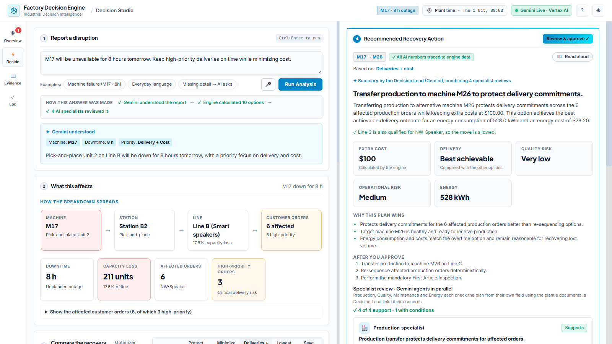

# Factory Decision Engine

> Before you change the factory, understand what happens next.

**[Open the live demo](https://factory-decision-engine-627710168651.asia-south1.run.app)** (no login, runs on
Google Cloud Run with Gemini on Vertex AI) · Google Cloud AI Builder Cup 2026, theme *Manufacturing:
Intelligent Operations & Industrial Efficiency* · Team **The Latency Breakers**: Aakash Doulwani (lead),
Sunil Raju



## The problem

When a machine stops in the middle of a shift, the plant manager has minutes to decide: move the work
to another machine, reshuffle the queue, or catch up with overtime after the repair. The facts they need
are spread across the production schedule, customer orders, machine manuals and quality rules, and
nobody knows exactly how long the repair will take. The decision is made on phone calls and gut
feeling, and the knock-on effects (which customer orders slip, which quality checks a transfer
triggers) show up later.

A general-purpose AI chatbot does not solve this: it writes confident text, but it can invent the very
numbers the manager is about to act on.

## The solution

The manager describes the problem in plain words, typed or spoken. In about 6 seconds the app shows:

1. **What the breakdown affects:** machine → station → line → customer orders → delivery risk.
2. **Every way to recover:** move work, reorder the queue or overtime, each checked against hard
   constraints and ranked on delivery, cost, quality, energy and risk.
3. **A recommendation reviewed by four Gemini specialist agents** (production, quality, maintenance,
   energy), with the documents they relied on.

Once a person approves, Gemini drafts the supervisor work order, quality notice, schedule changes and
customer update. **Nothing changes in the plant without a person's sign-off.**

**AI reasons, Python calculates.** Every number (lost units, cost, energy, delay, feasibility) comes
from a deterministic simulation and scoring engine. Gemini understands, reviews and explains, but
never produces an authoritative number, and a grounding check flags any number in AI-written text that
does not appear in the engine data or the cited documents.

## How Gemini and Google Cloud are used

| Where | What Gemini does |
|---|---|
| **Understanding a report** | Structured output turns *"the Unit 2 pick-and-place at B2 is down, maybe 6–10 h, keep it cheap, no overtime"* into machine, downtime range and priorities, validated against the plant's machine list. If the machine is unclear, it asks instead of guessing. |
| **Voice** | Transcribes a spoken report or question, keeping machine IDs and numbers exact (*"em seventeen"* → M17) and dropping machine noise. (Read aloud, which speaks the recommendation back, uses the browser's built-in speech.) |
| **Specialist war room** | Production, Quality, Maintenance and Energy agents review the plan in parallel, each citing the plant's own documents. A Decision Lead links their concerns (e.g. the first-article inspection Quality requires before Production runs on the new machine) and writes the brief. |
| **Ask about this plan** | A **Google ADK** tool-calling agent answers *"Why not overtime?"* or *"What if M26 breaks down too?"* by running new simulations, evaluations and document searches itself, and says what it ran. It remembers follow-up questions. |
| **After approval** | Drafts the four floor documents, carrying the specialists' conditions and the next steps. |
| **Grounding check** | Every number in AI-written text is checked against the engine data, the cited documents and what the manager typed; anything else is flagged on screen. |

**Google Cloud:** Cloud Run hosts the app; Gemini 3.5 Flash-Lite is reached through **Vertex AI** with the
service's own identity (no API keys); approved decisions are stored in **Firestore** with a **Cloud
Storage** backup copy. If Gemini is unavailable, the app keeps working in rule-based mode with identical
numbers and says so on screen.

## What is new here

- **Numbers you can trust, reasoning you can read:** a deterministic engine for every figure, Gemini
  agents for understanding and review, and a grounding check between them.
- **Robust to uncertain repairs:** the decision is re-run for every repair time from 1 to 48 hours,
  showing where the plan holds and where another option wins.
- **Predicts before it breaks:** a sensor-trend model flags machines heading for an alarm, even one whose
  status still reads "healthy", and builds the backup plan in advance.
- **Approval with conditions:** the manager approves the plan together with the specialists'
  conditions, and the drafted documents carry them.
- **Not tied to one industry:** a plant is a configuration pack (layout, products, documents), not new
  code. See [Plant configuration packs](#plant-configuration-packs).

## Try it in 3 minutes

1. **Open the [live demo](https://factory-decision-engine-627710168651.asia-south1.run.app).** A short
   guided tour starts on the first visit (the **?** button replays it).
2. **Factory Overview:** machine health, delivery pressure, what needs action now, and the early
   warning: M23 still reports healthy but is predicted to reach an alarm in about 17 hours, with its
   backup plan ready.
3. **Decision Studio:** press **Try the M17 example** (or type or speak your own report). The page reads
   top to bottom:
   - **1 Report a disruption:** Gemini states what it understood (M17, 8 hours, deliveries and cost).
   - **2 What this affects:** 211.2 units lost (17.6% of the line); 6 customer orders affected, 3 of
     them high-priority.
   - **3 Compare the recovery options:** 10 plans checked, 7 feasible, 3 not possible (each with its
     reason); a plant-floor map of where the work can go; whether the plan still holds if the repair
     takes longer.
   - **4 Recommendation:** move M17's work to M26 for an extra $100, reviewed by the four specialists
     (for example, Quality adds a first-article inspection as a condition).
4. **Ask about this plan:** *"What if M26 breaks down too?"* The ADK agent runs a new simulation and
   suggests the next-best machines. Changing the priority or ruling out overtime re-ranks the plans
   instantly (7 → 6 feasible plans, same recommendation).
5. **Review & approve:** approve with the specialists' conditions. The four documents are drafted,
   grounding-checked and recorded in the **Decision Log**.

## Honest limits of the prototype

- The plant, its orders, sensor history and documents are **synthetic** (Northwind Electronics Plant 1,
  a fictional factory).
- Machine faults are triggered by a demo button; in production they would stream from MES/PLC systems
  (e.g. through Pub/Sub).
- The early-warning model is a transparent trend extrapolation, not a trained model.
- The engine assumes a backup machine has free capacity and charges a flat transfer cost; it does not
  model labour skills. The assumed rates are listed with every decision.
- Approvers type their name; next step: **Firebase Authentication** so only signed-in, named approvers
  can sign off.

## Run it yourself

<details>
<summary><b>Run locally and run the tests</b></summary>

```powershell
py -3.12 -m venv .venv
.venv\Scripts\Activate.ps1
pip install -r requirements.txt
python scripts/generate_data.py            # builds one database per plant pack
copy .env.example .env                     # then paste your Gemini key into .env
python -m uvicorn app.api:app --env-file .env --port 8000
```

Open http://localhost:8000. Without a key the app runs in **rule-based mode**: every number and plan is
identical, and the AI features show as offline.

Tests: `python -m pytest` (213 pass, 1 live-key test skipped; Gemini is mocked, so no key or network is needed).

**Gemini quotas.** An analysis uses about 6 model calls (understanding, 4 specialists and a lead); an Ask
question adds a few, a voice note one, and approval one. Free-tier limits are low, so enable billing for
demos (an analysis then costs a fraction of a cent). The app spreads roles across models, skips a model that is
cooling down after a quota error, caches identical requests for 15 minutes and falls back to rule-based
results instead of failing.

</details>

<details>
<summary><b>Deploy to Google Cloud Run</b></summary>

On Cloud Run the app reaches Gemini through Vertex AI with the service's own identity (no API key,
billing through the project). The factory database is generated during the image build.

```powershell
gcloud config set project factory-decision-engine-01
gcloud run deploy factory-decision-engine --source . --region asia-south1 --allow-unauthenticated `
  --memory 1Gi --cpu 1 --timeout 300 --max-instances 3 `
  --set-env-vars "GOOGLE_GENAI_USE_VERTEXAI=TRUE,GOOGLE_CLOUD_PROJECT=factory-decision-engine-01,GOOGLE_CLOUD_LOCATION=global,GEMINI_MODEL=gemini-3.5-flash-lite,FDE_LOG_FIRESTORE=decisions,FDE_LOG_BUCKET=factory-decision-engine-01-decision-log"
```

One-time setup: enable the `run`, `cloudbuild`, `artifactregistry`, `aiplatform` and `firestore` APIs and
create a Firestore database; grant the default compute service account `roles/run.builder`,
`roles/aiplatform.user`, `roles/logging.logWriter` and `roles/datastore.user`, plus
`roles/storage.objectUser` on the log bucket only.

Decision log: with `FDE_LOG_FIRESTORE`, each approved decision is one Firestore document; with
`FDE_LOG_BUCKET`, Cloud Storage keeps a backup copy. If Firestore fails the log falls back to Cloud
Storage, and without either variable it is a local file.

</details>

## Architecture

```text
Browser (vanilla JS, no build)               FastAPI on Cloud Run (app/api.py)
 Factory Overview ────┐                       /api/analyze  /api/rerank  /api/review  /api/what-if
 Decision Studio ─────┼─── fetch ───────────▶ /api/ask      /api/transcribe (voice → Gemini)
 Engineering Evidence ┤                       /api/approve  /api/decisions /api/knowledge
 Decision Log ────────┘                       /api/factory/overview /api/watchlist /api/alerts
 voice notes · read aloud                                 │
                                      FactoryDecisionAgent (app/agent/agent.py)
     ┌──────────────────────────────┬──────────────┴───────────────┬───────────────────────────┐
 Understanding (Gemini,       Deterministic engine           ADK tool-calling agent      Specialist war room
 structured output,           simulation → recovery plans →  (simulate, evaluate,        Production ‖ Quality ‖
 validated vs registry)       feasibility → scoring →        knowledge search; Ask)      Maintenance ‖ Energy → Lead
 app/agent/understanding.py   evidence (app/simulation,      app/agent/tools.py          app/agent/specialists.py
                              recovery, evaluation)
                                     │
                              Robustness sweep (app/simulation/robustness.py)
                              Early warning (app/prediction/) · Q&A and approval docs (app/agent/assistant.py)
                              Decision log → Firestore, Cloud Storage backup (app/agent/decision_log.py)
```

| Path | Purpose |
|---|---|
| `app/ai/llm.py` | Gemini wrapper: structured output, model routing per role, quota cooldowns, voice transcription |
| `app/agent/` | Agent pipeline, understanding, specialists, assistant (Ask, approval documents), decision log |
| `app/simulation/`, `app/recovery/`, `app/evaluation/` | Deterministic engine (source of truth for numbers) |
| `app/prediction/` | Synthetic telemetry, early-warning trend model, alerts |
| `app/domains/` | Plant configuration packs |
| `app/knowledge/`, `knowledge/documents/` | Engineering knowledge base (SOPs, manuals, quality rules, incidents) |
| `app/ui/` | `index.html`, `style.css`, `app.js`, `js/views/` and `js/components/` (plant map, guided tour, voice) |
| `tests/` | pytest suite: engine, agents, grounding, approval documents, decision log, voice, UI API |

## Plant configuration packs

The demo runs one plant, **Northwind Electronics Plant 1** (Pune; lines: Routers · Smart speakers ·
Thermostats). The engine is not tied to one industry: it works for discrete-manufacturing plants built
from production lines, stations and machines. A
plant is a configuration pack in `app/domains/packs.py` (line names, process steps, products, fault
scripts) plus its engineering documents in `knowledge/documents/<pack>/`. Adding a factory means adding
a pack, not changing the engine.

The code also ships an automotive pack (Apex Automotive Plant 1, Chennai) with the same layout and
numbers on purpose: the regression suite runs on both, which checks that every calculation is
independent of the plant's vocabulary. Its selector is hidden in the demo because the numbers would be
identical; set `FDE_INDUSTRY_SWITCH=true` to show it or `FDE_DEFAULT_DOMAIN=automotive` to run it.
